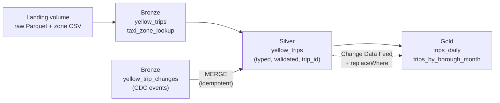

# NYC Taxi Lakehouse on Databricks

A Medallion lakehouse (Bronze → Silver → Gold) built on **Databricks Free Edition** with **Delta Lake** and **Unity Catalog**, using 22.6M NYC Yellow Taxi trips (Jan–Mar 2019).

The project rebuilds an earlier PySpark batch pipeline ([NYC_Taxi_PySpark_Batch](https://github.com/Qiuxia-Fu/NYC_Taxi_PySpark_Batch)) as a lakehouse. It adds ACID tables, versioned history, CDC upserts with `MERGE`, least-privilege governance and an orchestrated, Git-sourced Job. The row counts reconcile at every layer.

## Architecture



| Layer | Objects | Purpose |
|---|---|---|
| Landing | `nyc_taxi.landing.raw_files` (volume) | Raw source files, unchanged |
| Bronze | `yellow_trips`, `taxi_zone_lookup`, `yellow_trip_changes` | Raw data as Delta tables, plus lineage columns `_source_file` and `_ingested_at` |
| Silver | `yellow_trips` | Explicit data contract: snake_case names, explicit casts, 8 quality rules, zone and rate-code enrichment, surrogate key `trip_id` |
| Gold | `trips_daily`, `trips_by_borough_month` | Business aggregates: additive measures plus averages |

**Tech stack:** Databricks (serverless), PySpark, Spark SQL, Delta Lake, Unity Catalog, Lakeflow Jobs, GitHub.

## Reconciliation

| Step | Rows |
|---|---|
| Landing files | 22,612,607 |
| Bronze | 22,612,607 |
| Silver after quality rules | 21,965,805 (646,802 rows removed, 2.86%) |
| Silver after exact-duplicate removal | 21,965,804 |
| Silver after replaying CDC changes (−3 deletes, +4 inserts) | 21,965,805 |
| Gold Σ `trip_count` (both tables) | 21,965,805 |

Every Gold run ends with an `assert` that Σ `trip_count` equals the Silver row count. If it does not, the Job task fails and no inconsistent data is published.

## Key design decisions

### 1. Surrogate key based on profiling the data

The data has no natural primary key. A business key of `vendor_id, pickup/dropoff datetime, pickup/dropoff location` returned **55 duplicate keys**:

- **1** was an exact duplicate across all business columns. It was removed.
- **54** differed in distance, fare, payment type or passenger count. `vendor_id` identifies the meter vendor (only 1 or 2), not the vehicle, and the public data has no medallion number. So these are different trips that happen to share a key, and they were **kept**.

`trip_id = sha2(business key + trip_seq)`. `trip_seq` comes from `row_number()` with a total ordering over all business columns. Because the key is deterministic, the same trip gets the same `trip_id` on every rebuild, which is what makes CDC replay work (see 2). A quality gate asserts that `trip_id` is unique.

### 2. Idempotent CDC upserts with `MERGE`

Change events (`INSERT` / `UPDATE` / `DELETE`, with `_change_ts`) land in a Bronze change table. They are reduced to the latest event per `trip_id` and merged into Silver:

- A source with duplicate keys fails with `DELTA_MULTIPLE_SOURCE_ROW_MATCHING_TARGET_ROW_IN_MERGE`. The failed MERGE created no table version, which shows atomicity.
- First run: 5 updated, 3 deleted, 4 inserted. With deletion vectors, `numTargetRowsCopied = 0` and no existing file was rewritten.
- A naive re-run left the data unchanged (`exceptAll` = 0 both ways) but rewrote 9 rows and wrote 9 no-op pre/post images to Change Data Feed. A null-safe change-detection condition (`NOT (t.c <=> s.c)`) makes a re-run affect **0 rows**.

The result was verified three ways: `operationMetrics`, a row-level diff using time travel, and `table_changes`.

### 3. Least-privilege governance

| Role | landing | bronze | silver | gold |
|---|---|---|---|---|
| Data engineer (owner) | all | all | all | all |
| Analyst (`account users` as stand-in) | – | – | – | `USE SCHEMA` + `SELECT` |

Grants are made at schema level, so new Gold tables inherit them, and they are audited through `information_schema.table_privileges`. A test confirmed that Unity Catalog cannot revoke an inherited privilege on a child object (there is no DENY), so **schemas are the access boundary**.

## Orchestration

A Lakeflow Job runs the production pipeline as a DAG on serverless compute:

```
bronze → silver → apply_changes → gold        (~3 min end to end)
```

- **Git-sourced:** every run is pinned to one commit of `main`, and all tasks use the same code snapshot.
- **Rerun-safe:** every task is idempotent (overwrite, or `MERGE` with change detection), so retries and repair runs are safe.
- **Quality gates:** `assert`s fail the task and stop downstream tasks.
- **Full rebuild plus replay:** Silver is rebuilt from Bronze, then the CDC change table is replayed. A rebuild therefore does not lose merged changes, and the result matches the incremental path exactly.

The Job definition is in [`jobs/nyc_taxi_pipeline.yml`](jobs/nyc_taxi_pipeline.yml).

## Notebooks

**Pipeline (run by the Job)**

| Notebook | Purpose |
|---|---|
| `02_bronze` | Landing → Bronze, adding lineage columns |
| `03_silver` | Bronze → Silver: contract, quality rules, enrichment, `trip_id`, uniqueness gate |
| `03c_apply_changes` | Replay CDC events into Silver with an idempotent `MERGE` |
| `04_gold` | Silver → Gold aggregates, with reconciliation gate |

**Setup, governance and labs**

| Notebook | Purpose |
|---|---|
| `01_setup` | Catalog, schemas, volume |
| `01b_validate_landing` | Baseline checks on raw files |
| `01c_migrate_project3` | Port of the original PySpark logic (read-only) |
| `02b_delta_internals` | Transaction log, schema enforcement and evolution, deletion vectors |
| `03b_time_travel` | `VERSION/TIMESTAMP AS OF`, accidental delete and `RESTORE` |
| `04b_merge_lab` | Key profiling, CDC simulation, MERGE verification, idempotency tests |
| `04c_gold_incremental` | CDF-driven incremental Gold with `replaceWhere` and full-column reconciliation |
| `05_governance` | Unity Catalog grants and audit |

## How to run

1. Create a Databricks workspace (Free Edition is enough) and link GitHub under **Settings → Linked accounts**.
2. Clone this repo as a Git folder.
3. Run `01_setup`, then upload the TLC Parquet files for 2019-01 to 2019-03 and `taxi_zone_lookup.csv` to the landing volume.
4. Create the Job from `jobs/nyc_taxi_pipeline.yml`, or run the pipeline notebooks in order.
5. Optional: run `04b_merge_lab` (section 4.3) to generate the CDC change table, then rerun the Job.

## Known limitations and future work

- **Credentials:** the Job pulls code with a personal access token, which expires. In production the Job should run as a service principal with its own Git credential.
- **Single-user environment:** grants were verified through grant records and audit views. A multi-user setup should add a negative test with an analyst account.
- **Simulated CDC:** change events are generated from Silver. A real source would be a database CDC stream with sequence numbers to break ties between events that share a timestamp.
